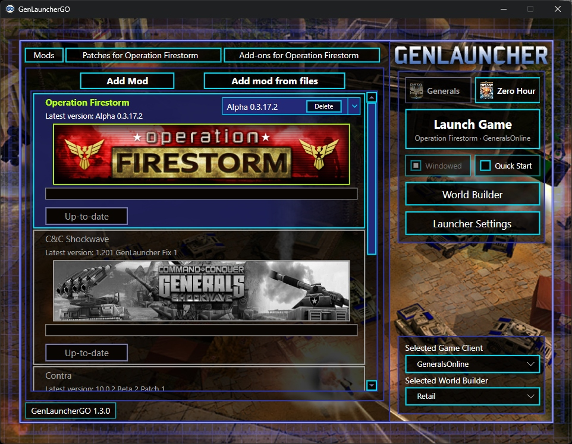

# GenLauncherGO

GenLauncherGO is a portable Windows mod manager and launcher for **Command & Conquer: Generals** and
**Zero Hour**. It supports the retail games alongside community clients from
[TheSuperHackers](https://github.com/TheSuperHackers/GeneralsGameCode) and
[GeneralsOnline](https://www.playgenerals.online/).

It downloads, installs, updates, and launches supported mods, patches, and add-ons while keeping supported game
installations as clean as possible. This codebase is a complete rewrite of
[x64-dev/GenLauncher_GO](https://github.com/x64-dev/GenLauncher_GO), which was derived from the original
[GenLauncher project](https://github.com/p0ls3r/GenLauncher).

## Features

- Manage mods, patches, add-ons, and manually imported content.
- Share configured Generals and Zero Hour installations across multiple mods.
- Manage both games from one portable launcher that updates itself.
- Verify downloaded content before launch, and restore the game folder after an interrupted launch.

## Quick Start

### Requirements

- Windows 10 or 11.
- **Recommended:** GenLauncherGO on the same NTFS drive as your games, so launches link mod files instead of copying
  them ([why](docs/reference.md#same-drive-as-your-games)).
- A clean Generals or Zero Hour installation with no other modifications in its game directory, preferably outside
  `Program Files`, because User Account Control (UAC) can interfere with modding tools.
- A supported game client ([detected executables](docs/reference.md#supported-game-clients)).

### Steps

1. Extract the complete `GenLauncherGO-win-Portable.zip` outside any game installation, ideally on that same drive.
   Keep its files and folders together.
2. Run the root `GenLauncherGO.exe` and select one or both game installation folders. Each must contain at least one
   of the game's core data archives:
   - Generals: `INI.big`, `W3D.big`, `Textures.big`, `Terrain.big`, or `Window.big`
   - Zero Hour: `INIZH.big`, `W3DZH.big`, `TexturesZH.big`, `TerrainZH.big`, or `WindowZH.big`
3. Choose a game client and the content you want to use, then launch the game or World Builder.

GenLauncherGO places the mod files in the game folder for that session and removes them after the game closes.

## Your Data

Settings, installed content, and logs live in the `GenLauncherGO Data` folder beside `GenLauncherGO.exe`; logs are in
its `Logs` subfolder. The [full folder layout](docs/reference.md#launcher-folder-layout) is in the reference.

## Contributing

Contributions are welcome. See [CONTRIBUTING.md](CONTRIBUTING.md) to get started.

## License

Code and documentation authored for this repository are licensed under GNU GPL version 3 only (`GPL-3.0-only`).
See [LICENSE](LICENSE) for the license text. Bundled image and icon files, including backgrounds, covers, banners,
emblems, and screenshots, are excluded from this license grant. Their rights remain with their respective owners.

## Support

- [GitHub issues](https://github.com/Jaredl-Dev/GenLauncherGO-Rewritten/issues/new/choose): Launcher bug reports and feature requests.
- [GeneralsOnline Discord](https://discord.playgenerals.online): Setup help, mod questions, and community discussion.
- [GeneralsOnline website](https://www.playgenerals.online/).

## Credits

- **p0ls3r** — Original creator of GenLauncher and the project from which the predecessor launcher was derived; also
  allowed GenLauncherGO to use the existing backend.
- **x64-dev** — Originator of the predecessor GenLauncherGO project and creator of GeneralsOnline.
- **Jaredl-Dev** — Rewrote the predecessor GenLauncherGO application.
- **Zeke** — Created the Generals and Zero Hour backgrounds used by the launcher.

## Disclaimer

GenLauncherGO is a community-developed tool. It is not created by, endorsed by, or affiliated with Electronic Arts or
any other rights holder unless explicitly stated.

This rewrite began in a fork of `x64-dev/GenLauncher_GO` and now lives in a standalone repository. Its Git history was
reconstructed into reviewable milestones; commit dates across May–September 2026 approximate the development period,
not the exact completion date of each feature.
